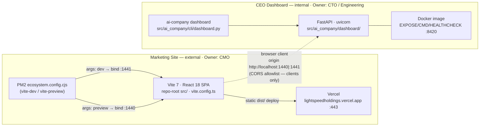

# Reference Architecture — Marketing Site / CEO Dashboard Boundary

**Date:** October 10, 2026
**Author:** Solution Architect (Technology)
**Authority chain:** CSO directive (`app-naming-and-port-assignments.md` v1.0) → CTO ratification (`cto-ratification-marketing-site-dashboard-boundary.md` v1.0) → this view
**Status:** Living document. Diverges from `AGENTS.md` §12/§13 or the CTO ratification only via the change control in the ratification §7 (CSO + CTO authorization).

---

## 1. Scope

Reference architecture for the two-application boundary: component topology, port
ownership, health contracts, the single intentional coupling (CORS), and the
guardrail stack that prevents cross-serving regressions. Changes no code; it is
the engineering-facing structural view of the ratified boundary.

## 2. Component Diagram

**Runtime/ops attributes (ratified, verified 2026-10-10):**

| | Marketing Site | CEO Dashboard |
|---|---|---|
| Runtime | Node.js · Vite 7 · React 18 SPA | Python 3.12 · FastAPI · uvicorn |
| Launcher | PM2 `ecosystem.config.cjs` (`vite-dev`, `vite-preview`) or `npm run dev/preview` | `uv run ai-company dashboard` or Docker `CMD` |
| Source root | repo-root `src/`, `vite.config.ts` | `src/ai_company/dashboard/`, `src/ai_company/cli/dashboard.py` |
| Bind ports | **1441** dev (`server.port`), **1440** preview (`preview.port`) | **8420** prod, **8421** dev/staging (staging compose maps host 8421 → container 8420) |
| Health contract | `GET /` → HTTP 200 + HTML (SPA shell). **No `/health` exists.** | `GET /health` → HTTP 200 + JSON `status: "ok"|"degraded"`, auth-exempt (ADR-012) |
| Deploy target | Static `dist/` → **Vercel :443**; PM2 only for local dev/preview | **Docker** → internal infra (prod `8420:8420`, staging `8421→8420`) |
| Network domain | External | Internal |
| Owner | Chief Marketing Officer | CTO / Engineering |

## 3. Port Ownership Matrix (hard boundary)

| Port range | Sole binder | Never bound by |
|---|---|---|
| 1440, 1441 | Marketing Site (Vite dev/preview via PM2) | Dashboard CLI/compose/Docker (any `--port` override) |
| 8420, 8421 | CEO Dashboard (uvicorn / Docker) | Vite config, PM2 apps, `vite --port` override |

CORS allowlist entries are permitted **origins**, not port assignments — they do
not grant either app the right to bind the other's port (ratified rule 3).

## 4. Single Intentional Coupling — CORS

The only designed interaction between the two apps: the Marketing Site's **browser
client** calls the Dashboard **API server** cross-origin.

- **Mechanism:** `CORSMiddleware` on the FastAPI app; default localhost-only
  allowlist hard-codes Marketing Site origins
  `http://localhost|127.0.0.1:{1440,1441}` plus legacy `:3000`/`:5173`
  (`src/ai_company/dashboard/app.py:454-484`).
- **Override:** `DASHBOARD_CORS_ORIGINS` (comma-separated) in
  `docker-compose.yml` and `docker-compose.staging.yml`; wildcard `*` is
  rejected (GAP-010).
- **Direction:** one-way. Dashboard trusts the site's origin as a *client*; the
  site exposes no server surface to the dashboard and shares no runtime, process
  manager, health check, or deploy pipeline.
- **Coverage:** `tests/unit/test_dashboard_security.py` asserts the default
  allowlist includes the 1440/1441 origins.

Everything else — runtimes, ports, health checks, deploy targets, release
cycles, ownership — is deliberately decoupled.

## 5. Health-Contract Identity Probes

Content type on the assigned port is the identity signal. Wrong content type =
cross-serving = port-boundary incident, even when HTTP 200
(`docs/sop-incident-response-v2.md` Step 3; `docs/sop/operations-sop.md` §5.5).

| Probe target | Must return | Fails when |
|---|---|---|
| `:8420/health`, `:8421/health` | JSON with `status: "ok"` | HTML (site cross-serving on a dashboard port) |
| `:1441/`, `:1440/` | HTML (Vite/SPA shell) | JSON `status` payload (dashboard cross-serving on a site port) |

Consumers: Docker `HEALTHCHECK` (`:8420/health` only), CI e2e dashboard gate
(8421 only), `scripts/dev/health-check.ps1` (1441/1440 only). Never point the
Docker `HEALTHCHECK` or CI dashboard gate at 1440/1441, or the Vite readiness
poll at 8420/8421. Cold-start caveat: first dev request on 1441 may exceed 15 s
(retry once after the `VITE ready in ...` log line; allow ≥30 s — `AGENTS.md` §12).

## 6. Guardrail Stack (prevention layers)

| Layer | Control | State (verified 2026-10-10) |
|---|---|---|
| Static config guard | **G-1** `tests/unit/test_port_assignments.py` — asserts vite `server/preview` ports, PM2 app ports, dashboard CLI default 8420, compose mappings, and `dashboard_ports ∩ vite_ports == ∅`; runs in the existing pytest CI gate | **Missing** (ratification P0) |
| Runtime fail-fast (dashboard) | **G-2** Dashboard CLI refuses `--port 1440`/`1441`, naming the Marketing Site, non-zero exit (pattern of existing ADR-012 loopback guard in the same function) | **Missing** (P0) |
| Runtime fail-fast (vite) | **G-3** Inline Vite plugin via `configResolved` throwing if resolved `server.port`/`preview.port` ∈ {8420, 8421}, catching `vite --port` overrides | **Missing** (P0) |
| Frontend-only CI gate | **G-6** Port-assertion step in `site-principles-gate.yml` (already triggers on `vite.config.ts`) so a frontend-only PR cannot retarget ports without Python CI | **Missing** (P1) |
| Port-binding identity audit | **G-5** `scripts/dev/verify-port-bindings.ps1` — maps listeners on the four ports to node/vite vs python/uvicorn processes and runs the §5 probes | **Missing** (P1) |
| PM2 parity/portability | **G-4** Repo-relative `script` + `cwd: __dirname`; `port` fields documented as declarative metadata (parity enforced by G-1) | **Partial** (ports correct; absolute `.exe` path F2 remains) |
| Residual-risk record | **G-7** Note in directive §5: production site is Vercel :443, so prod cross-serving is structurally impossible; exposure is local/dev/staging only | **Missing** (P2) |
| Health-gate wiring | Docker `HEALTHCHECK` → `:8420/health`; CI e2e dashboard poll → 8421 `/health`; `health-check.ps1` → 1441/1440 HTML | **Exists** |
| CORS coupling coverage | `test_dashboard_security.py` default-allowlist assertions | **Exists** |
| Documentation/SOPs | `AGENTS.md` §12/§13, naming doc, CTO ratification, four ops/marketing/engineering SOPs with cross-serving fail rules | **Exists** |
| Change control | Port repoint requires CSO + CTO authorization; G-1…G-6 ship as one ECL change (ratification §7) | **Exists** (process) |

**Defense-in-depth shape once P0s land:** static test (merge-time) → runtime
fail-fast (process-start-time) → identity probes (run-time) → SOP containment
(incident-time). Today only the outer two layers exist; G-1/G-2/G-3 close the
fail-fast and merge-time gaps.

## 7. Invariants (machine-checkable target state)

1. `vite.config.ts`: `server.port == 1441`, `preview.port == 1440`.
2. `ecosystem.config.cjs`: `vite-dev → 1441`, `vite-preview → 1440` (metadata parity with #1).
3. Dashboard CLI default `== 8420`; compose prod `8420:8420`; staging default host `8421`.
4. `{1440, 1441} ∩ {8420, 8421} = ∅` enforced in config, at process start, and by probe.
5. A JSON `status` body on 1440/1441, or HTML on 8420/8421, is always an incident — never a pass.

## 8. Related Documents

- `docs/organization/app-naming-and-port-assignments.md` — CSO directive (naming/ownership/port authority)
- `docs/organization/cto-ratification-marketing-site-dashboard-boundary.md` — ratification, evidence, guardrail actions G-1…G-7
- `AGENTS.md` §12/§13 — executable agent guidance (keep in lockstep with the ratification)
- `docs/sop-incident-response-v2.md`, `docs/sop/operations-sop.md` — cross-serving containment runbooks

---

## Revision History

| Date | Version | Author | Change |
|---|---|---|---|
| 2026-10-10 | 1.0 | Solution Architect | Initial reference-architecture view of the ratified Marketing Site / CEO Dashboard boundary |
