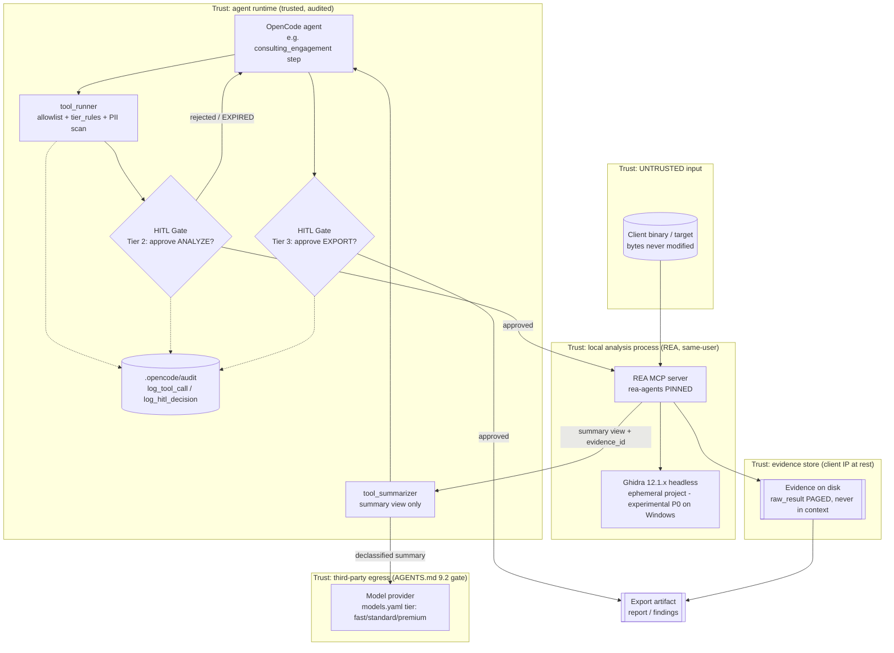
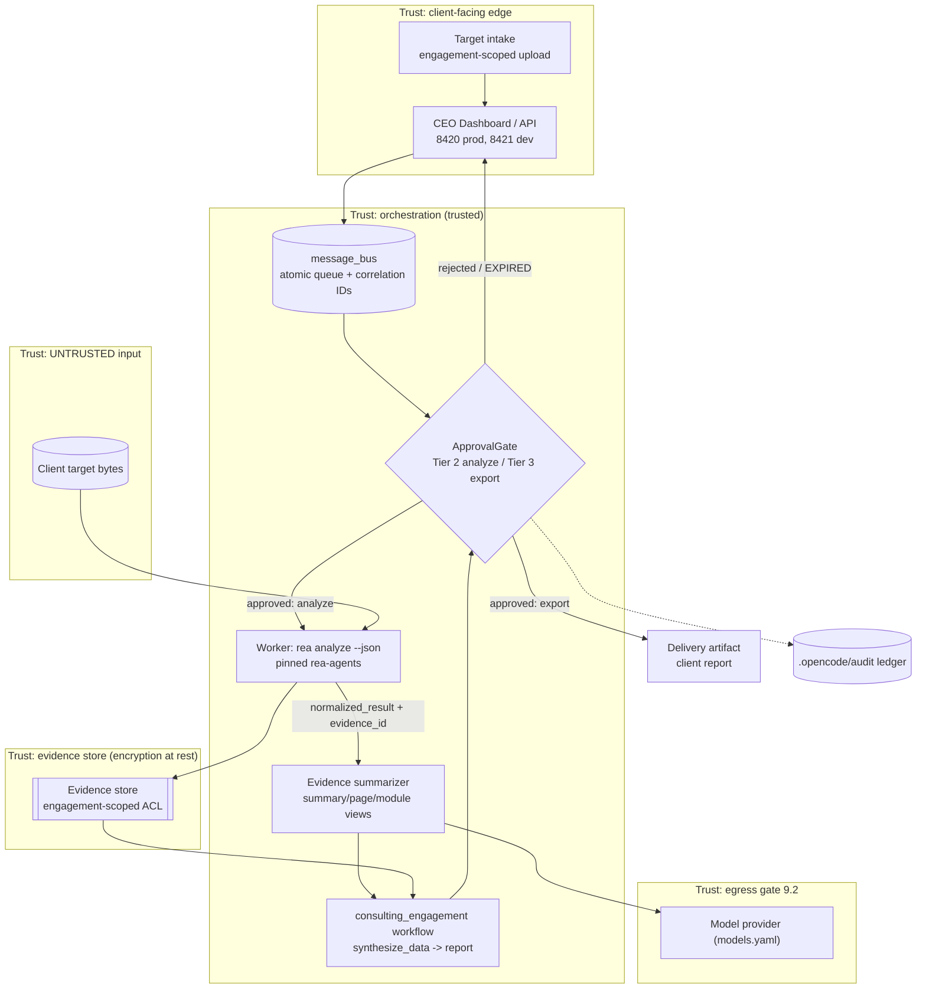
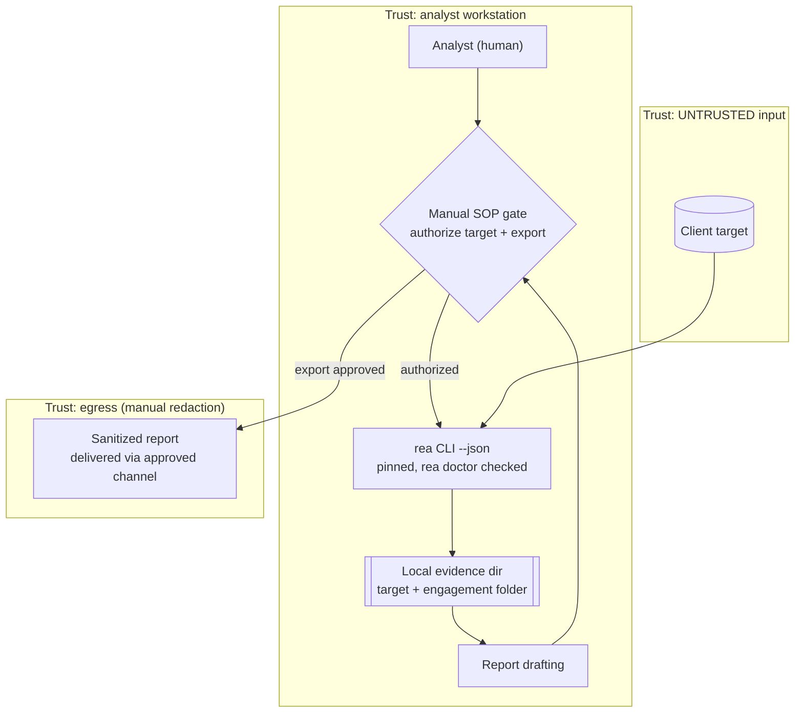

# Phase 1 — Technical Feasibility: Reverse Engineer Anything (REA) Adoption

**Date:** 2026-10-17
**Author:** Chief AI Officer (AI Research), with solution-architecture perspective
**Scope:** Technical feasibility of adopting `morluto/rea` (npm `rea-agents`) for Lightspeed Holdings — integration architectures, orchestration fit, effort, Windows 11 reality, evidence handling, model mapping, and pre-commitment spikes.
**Grounding:** All REA capability claims cite the shared brief `reports/rea-feasibility/00-rea-capabilities.md` by section/source ID (e.g., "brief §4 / S7"). All Lightspeed-stack claims cite repository source files read for this report. Items not verified are marked **UNVERIFIED**.

---

## 0. Executive summary

REA is a local MCP server + CLI (MIT, pinned npm `rea-agents`) that gives an AI agent one uniform investigation surface over native binaries, JS/Electron, .NET, APKs, captures, and more, returning snapshot-keyed Evidence records (brief §1 / S1, S7). It fits our stack mechanically — it is a stdio MCP server our executor can call through the same allowlist/tier/HITL machinery that already governs every tool call — but three things gate adoption: **(1)** our primary OS is Windows 11, where the free native provider (Ghidra) is explicitly *experimental P0 read-only* (brief §5 / S9); **(2)** Evidence can reach hundreds of MB and must never enter agent context wholesale (brief §4 / S7); **(3)** analysis runs locally but results flow to the model provider, which is a policy decision under AGENTS.md §9.2 (third-party transmission ban) and client IP contracts (brief §3 / S4, S2).

**Recommendation (detail in §8):** Architecture **A — REA as an MCP tool inside the agent runtime**, entered through five time-boxed spikes (≈8 days total), with Architecture C (standalone analyst workstation) used only as the validation vehicle for the Windows Ghidra gap, and Architecture B (client-facing service backbone) deferred until A is production-hardened.

---

## 1. Integration architectures

Three candidate architectures were evaluated. Each diagram shows data flow, trust boundaries (dashed subgraphs), and HITL points (diamond nodes).

### 1.1 Architecture A — REA as an MCP tool in the agent runtime (OpenCode executor)

The agent runtime calls REA like any other tool: REA is registered as a local MCP server, its tool names are added to the executor allowlist, and every call passes through tier classification → ApprovalGate → audit before execution. Raw Evidence is written to disk; the agent context receives only the `summary` view plus `evidence_id` handles (brief §4 / S7).

**Data flow:** task (message bus) → allowlist + tier classification → HITL before analyze → REA MCP call (shlex-sandboxed, no shell) → Evidence to disk → summary view into context via tool_summarizer → HITL before export → report artifact.
**Trust boundaries:** untrusted target bytes; same-user REA/Ghidra process (REA is *not* a sandbox — brief §3 / S4); evidence store holding client IP; model-provider egress.
**HITL points:** before analyzing a client target (Tier 2, matches `HITLGates.require_approval_from_tier = 2` default), before exporting findings (Tier 3, two-person).
**Registration mechanism:** REA advertises auto-registration for Claude Code/Codex/Cursor/Gemini CLI/Grok Build plus manual MCP registration for others (brief §1 / S2, S8). OpenCode's exact MCP config surface and REA's MCP protocol version compatibility with our in-house stdio server conventions (`PROTOCOL_VERSION "2025-06-18"`, `src/ai_company/mcp/server.py`) are **UNVERIFIED** → Spike 2. The exact MCP serve command (e.g., `rea mcp` vs `npx rea-agents …`) is likewise **UNVERIFIED** → Spike 2 (docs/mcp-contracts.md, S7).

### 1.2 Architecture B — REA as the backbone of a client-facing consulting service

REA runs as a worker-side engine behind the FastAPI CEO Dashboard / orchestrator: client target intake creates a bus task, the worker executes `rea analyze --json` (brief §1 / S6), Evidence lands in a managed store, and findings flow into the existing `consulting_engagement` workflow (`company/registry-templates/consulting-firm/config/workflows/workflows.yaml`: onboarding → deploy_interviews → synthesize_data → identify_opportunities → draft_roadmap → executive_briefing).

**Data flow:** intake → bus task (`Task.requires_approval = True`) → approval → worker runs REA CLI → Evidence store → summarizer → workflow steps → second approval → delivery.
**Trust boundaries:** client-facing intake; worker execution of untrusted bytes (Ghidra/JVM); evidence store (strongest client-IP concentration); egress.
**HITL points:** same two gates as A, but enforced at the service layer rather than per tool call.
**Fit note:** maximizes reuse of `message_bus.py` (atomic FileStore writes, correlation IDs, parent/child linkage, broadcast hooks) and `approval.py` (id-anchored `data/orchestrator/approvals.yaml`, `.opencode/audit` ledger, archive/retention). Heaviest build: worker lifecycle, concurrency, encryption at rest, client-facing QA.

### 1.3 Architecture C — Standalone analyst workstation

An analyst runs the `rea` CLI directly on their Windows 11 machine; Evidence stays in a local directory; approvals are human SOP, not system-enforced; only a sanitized report leaves the workstation.

**Data flow:** human-gated CLI runs → local Evidence → report → human-gated export.
**Trust boundaries:** the workstation itself; manual redaction before egress.
**HITL points:** both gates exist but are procedural (checklist), not enforced by ApprovalGate — no audit ledger, no tier rules, no dead-letter handling.
**Fit note:** cheapest path to *validating* REA on Windows (it is effectively Spike 1's home), but it does not productize the capability and it leaves client IP on an unmanaged disk.

### 1.4 Architecture comparison

| Criterion | A: agent runtime MCP | B: consulting service | C: analyst workstation |
|---|---|---|---|
| Reuses ApprovalGate / tier rules / audit | ✅ native (tool_runner path) | ✅ at service layer | ❌ manual SOP |
| Reuses message bus + dashboard | ✅ task-driven | ✅ designed around it | ❌ |
| Evidence/context control | ✅ tool_summarizer + paging | ✅ strongest (managed store) | ⚠️ manual discipline |
| Effort to MVP (see §3) | ~10 pd | ~19 pd (reuses A) | ~2 pd |
| Client-facing productization | ⚠️ indirect | ✅ direct | ❌ |
| Windows native-analysis risk | inherited (Ghidra P0) | inherited + worker OS choice | isolated to one workstation |
| Enforcement of §9.2 egress gate | per call (tier + PII scan) | per delivery | manual |

---

## 2. Orchestration fit (message bus, ApprovalGate, audit)

The executor already has every primitive REA integration needs; integration is *wiring and policy*, not new infrastructure.

| Concern | Existing mechanism (verified in source) | REA integration |
|---|---|---|
| Task dispatch | `src/ai_company/orchestrator/message_bus.py` — JSON queue with FileStore atomic writes, file locking, correlation IDs, parent/child linkage, ACK tracking, dashboard broadcast hooks, optional SQLite write-through | Analysis jobs enqueue as `Task` with `requires_approval = True`; correlation ID becomes the join key from task → evidence folder → report |
| Approval | `src/ai_company/orchestrator/approval.py` — `ApprovalGate`, id-anchored `data/orchestrator/approvals.yaml` (SCHEMA_VERSION 1), UTC timestamps, retention/archive, durable audit ledger via `.opencode/audit` (ticket #59); `src/ai_company/executor/hitl_gate.py` — `request_and_wait()` future, `request_and_wait_sync()`, `resolve_approved()` poll-and-resume | Two gates per engagement run: **G-A (analyze)** and **G-X (export)**; expired approvals are terminal (AGENTS.md §9.1 sweep → resubmit) |
| Tier classification | `src/ai_company/orchestrator/tier_rules.py` — `ApprovalTier` AUTO_APPROVE=0 … SINGLE_APPROVER=2, TWO_PERSON=3, CEO_ONLY=4; `SENSITIVE_PATHS` escalates to Tier 4; `classify_tool_action` invoked by tool_runner | Register REA tool names: analysis calls → Tier 2 (matches `HITLGates.require_approval_from_tier = 2` default in `models/models.py`); export/delivery tools → Tier 3; evidence paths containing secrets/legal/compliance material → Tier 4 via path rules |
| Execution sandbox | `src/ai_company/executor/tool_runner.py` — shlex parsing (never `shell=True`), `config/tool_allowlist.yaml` allowlist, path sandboxing, output content-safety/PII scan, tier-rule integration, audit via `log_tool_call` / `log_hitl_decision` | Seed allowlist with REA tool names only after Spike 2's `tools/list` (tool count **UNVERIFIED**, brief §1 / S7); REA outputs pass the PII/content scan before reaching context — first line of the §9.2 egress defense |
| Failure handling | `dead_letter.py`, daemon sweeps | REA provider failures (e.g., Ghidra P0 refused op, ambiguous provider per brief §1 / S11) → dead-letter with evidence_id preserved for replay |
| Dashboards | Broadcast hooks on message bus; CEO Dashboard 8420/8421 | Approval requests and analysis progress surface as notifications; no new port, no new service |

**Proposed approval policy (both gates are user-required):**

1. **G-A before analyzing a client target:** Tier 2 single approver — the analyst's manager/lead confirms the target is in-scope for the engagement (authorization per REA's own responsible-use positioning, brief §2 / S2).
2. **G-X before exporting findings:** Tier 3 two-person — one author, one reviewer confirm (a) no unredacted client code leaves the evidence store, (b) `coverage.scope`/`coverage.status` limitations are disclosed (brief §4 / S7), (c) the receiving model/delivery channel is §9.2-compliant.
3. Both decisions land in the `.opencode/audit` ledger alongside `log_tool_call` records, so a later audit can reconstruct: task → approval → tool call → evidence_id → export.

**Policy dependency (not technical):** AGENTS.md §9.2 bans transmitting LightSpeed/client local data to third-party hosts unless the vendor is on `docs/APPROVED-VENDORS.md` within 90 days (CISO of record: Jack Mlusu). REA itself never uploads targets (brief §3 / S6 FAQ), but **tool results flow to the model provider** — decompiled client code reaching Big Pickle/Gemini/any cloud model is a policy decision that must be checked against the vendor list and client contracts *before* Spike 4. On unexpected transmission: stop, do not retry, report skill + host + payload class to the CEO.

---

## 3. Effort estimates (person-days)

Planning-grade estimates for **one engineer**, ±50%. "MVP" = one analyst can run a gated analysis end-to-end on Windows with audit; "Production-hardened" = CI-tested, pinned, egress-gated, Linux lane available, runbooked.

| Work item | A MVP | A Prod | B MVP | B Prod | C MVP | C Prod |
|---|---:|---:|---:|---:|---:|---:|
| Environment & version pinning (Node ≥22.19, Ghidra 12.1.x + JDK 21, `rea doctor`) | 1.5 | 2.0 | (reuse A) | (reuse A) | 1.0 | 1.5 |
| MCP registration / CLI wiring + allowlist seeding (`tools/list`) | 2.0 | 2.5 | 1.0 | 1.5 | — | — |
| Approval wiring: G-A/G-X gates, tier rules for REA tools + evidence paths | 2.0 | 3.0 | 1.5 | 2.5 | 0.5 (SOP doc) | 1.5 (checklist + review) |
| Evidence pipeline: on-disk store, summary/page views, tool_summarizer extension, token budgets | 2.5 | 5.0 | 2.0 | 4.0 | 0.5 (folder convention) | 1.5 (retention + backup) |
| Service layer (bus task type, worker, dashboard surfacing, export template) | — | — | 4.0 | 7.0 | — | — |
| Audit/dead-letter integration + PII-scan tuning for REA payloads | 1.0 | 2.0 | (reuse A) | 1.5 | — | — |
| Egress controls (§9.2): vendor check, redaction step, local-model path | 0.5 | 2.5 | 0.5 | 3.0 | 0.5 | 1.5 |
| Linux lane for firmware/pcap/signals (WSL2 or container worker) | — | 3.0 | — | 4.0 | — | 2.0 |
| Tests + CI (contract tests vs REA JSON, regression on pinned version) | 1.0 | 3.0 | 1.0 | 3.0 | — | 1.0 |
| Docs / runbook / analyst SOP | 0.5 | 1.5 | 0.5 | 2.0 | 1.0 | 1.5 |
| **Total (person-days)** | **~11** | **~25** | **~19** | **~34** | **~3.5** | **~10.5** |

**Reading:** C is a validation vehicle, not a product. A is the cheapest *governed* capability (~11 pd MVP, ~25 pd hardened). B reuses A's core and adds service weight. Sequencing A→hardened-A→B avoids rebuilding approval/evidence logic twice.

---

## 4. Windows 11 compatibility

Facts (brief §2 / S8, §3 / S4, §5 / S9) and what they mean for us:

| Requirement / fact | Windows 11 status | Action |
|---|---|---|
| Node.js 22.x ≥22.19 / 24.x ≥24.11 / 26+ + npm | Satisfied (install/upgrade node) | Pin in environment manifest (Spike 1) |
| Ghidra native provider | **Experimental P0, read-only, 26 operations**, operator-installed Ghidra 12.1.x (verified 12.1.4) + JDK 21+; Windows npm builds bundle native process/filesystem/DACL controls; authenticated loopback TCP bridge with private NTFS runtime dir (DACL = current user + SYSTEM) | The entire free Windows native stack rests on an explicitly experimental provider — validate first (Spike 1) |
| PE coverage on Windows npm | Releases through 5.0.0 are x86-64-PE-only; x86 support landed on main afterwards — whether current `rea-agents` 6.5.0 ships x86 is **UNVERIFIED** | Confirm in Spike 1 if 32-bit client targets matter |
| Hopper | Commercial, macOS-first; setup may install with approval | Not our Windows path; licensing is the operator's responsibility (brief §2 / S2) |
| IDA Pro | Commercial; REA adapts upstream `mrexodia/ida-pro-mcp` (brief §1 / S10); REA grants **no** license (brief §2 / S2) | Procurement decision; defer — Kuna (Apache-2.0, free) is the secondary free engine (brief §1 / S11) |
| **Linux-only targets** — firmware (Binwalk/Unblob), packet captures (TShark), recorded logic signals (sigrok-cli), recorded Linux crashes | **Cannot run on Windows 11** (brief §1 / S2 README table) | Options: WSL2 (**UNVERIFIED** whether REA-in-WSL2 works — Spike 5), container/compose worker (repo already has `--profile worker`), or a rented Linux box (egress-gated) |
| Static JS/Electron, .NET, APK (JADX), SQLite, WASM, packages/Apple resources | No native engine required / works on Windows (brief §1 / S2) | Day-one usable capability on Windows even if Ghidra P0 disappoints — important: **a large share of consulting-relevant targets (web/Electron/apps) does not depend on the experimental provider** |
| Process behavior capture | Executes the target under operator permissions (brief §1 / S2) | Never on untrusted client binaries without explicit Tier-3-style approval; default-off |

**Windows conclusion:** Windows 11 is viable for the *static, engine-free* target classes immediately; native disassembly viability is a bet on an experimental provider and must be proven (Spike 1) before any commitment that depends on it. Linux-only target classes require a second lane regardless (Spike 5).

---

## 5. Evidence pipeline — hundreds of MB → reports without blowing context

The brief is explicit (§4 / S7): every MCP tool returns a canonical Evidence record (`normalized_result`, `evidence_id`, `raw_result`, `analysis_profile`) in both `text` and `structuredContent`; Evidence can reach **hundreds of MB** (documented example: 334 MB analysis → ~10 KB summary view); retrieval is paged via `summary` / `page(collection, offset, limit)` / `module` views; results are snapshot-keyed (target bytes + operation + parameters + provider + settings).

**Design (three layers):**

1. **Off-context storage (write path).** Every Evidence record lands on disk under an engagement/task-scoped folder keyed by `evidence_id` (join via the bus correlation ID). `raw_result` never enters the model context. Snapshot metadata (the snapshot key) is stored alongside for reproducibility/re-runs.
2. **Context admission (read path).** The agent context receives only: the `summary` view, `evidence_id` handles, and — on explicit, budgeted demand — a single `page` view with byte/token caps. Admission is enforced by extending `tool_summarizer.py` (already compresses verbose tool output with `count_tokens` budgets, currently PowerShell/stack-trace oriented) with an Evidence adapter: keep `normalized_result` + `coverage` + `analysis_profile`; strip/redact `raw_result`. `history_manager.py` keeps the window bounded; `Guardrails.llm_budgets` / `tier_budget_overrides` (models.yaml degradation) cap spend if a session over-consumes.
3. **Report synthesis (export path).** Reports are assembled from *selected* evidence (report writer reads the on-disk store directly, not through the LLM), then G-X approves export. The LLM drafts narrative around the `normalized_result` values; it never re-derives findings from raw dumps.

**Correctness guardrails baked into the pipeline:**
- Check `coverage.scope` (`root` | `container-entries`) and `coverage.status` (`complete` | `unknown`) before any "complete inventory" claim (brief §4 / S7; shared-fact 13).
- JS caveat: `import type` / `export type` are source facts, not runtime edges (brief §4 / S12) — carried into the report template as a standing caveat.
- `analysis_profile` may be `null` — record that explicitly; snapshot key is the reproducibility anchor for re-runs after pin bumps.
- PII/content scan (tool_runner) runs on whatever enters context — defense-in-depth for §9.2.

**Token math (sanity check):** summary views ≈ 10 KB per large target (brief §4 / S7) ≈ ~3k tokens — negligible. The failure mode is never the summary; it is an agent that calls `page` in a loop or pastes `raw_result`. Both are prevented by (a) per-session admission caps and (b) allowlisting summary-first tool usage patterns in the agent's prompts.

---

## 6. Model requirements → `company/models.yaml` provider mesh

| REA workload | Requirement | models.yaml mapping (verified) |
|---|---|---|
| Driving an investigation (multi-step reasoning over findings) | Strong reasoning, long context | **Premium tier** — OpenCode (Big Pickle) is the standard/premium default; per-agent override layer can pin the consulting/reverse-engineering agent to premium |
| Evidence summarization / page digestion (high volume, low reasoning) | Cheap, fast, token-budgeted | **Fast tier** — Gemini Flash is the fast-tier default; per-agent override for the summarizer role |
| Client-confidential evidence (if contract/§9.2 forbids cloud egress) | Zero third-party transmission | **Local providers** — Ollama + llama.cpp are already in the mesh; route the summarizer-only leg locally. Spike 4 proves fidelity on redacted/summary payloads |
| Long sessions approaching budget caps | Degrade, don't fail | `tier_budget_overrides` / budget degradation already in models.yaml — rotate summarization to fast/local tier as spend rises |
| Fallback when primary provider is down | Continuity | Existing fallback chains with **MiMo placed at the end**; Deepseek/Kimi remain excluded (no African payment path); OpenAI/Anthropic catalog-only unless activated |

**Operational notes:** three routing layers already resolve model choice (per-agent override > tier routing > provider defaults) — no new routing code needed, just an agent-role entry. Provider auth follows the existing `{ID}_API_KEY` env-var + OAuth2 client-credentials opt-in pattern; no new secret classes. **Mapping consequence:** the only *new* policy work is deciding which tier is legally allowed to see which evidence class — encode it as the per-agent override for the REA-calling agent plus a hard rule that `raw_result` never reaches *any* provider (only summaries), which shrinks the §9.2 review surface from "decompiled binaries" to "structured findings."

---

## 7. Pre-commitment spikes (time-boxed)

No commitment beyond Phase 1 until all five report out. Total ≈ 8–10 working days.

| # | Spike | Box | Pass criteria |
|---|---|---|---|
| 1 | **Windows Ghidra P0 reality check** — install Node ≥22.19, Ghidra 12.1.x + JDK 21, pinned `rea-agents`; `rea doctor`; analyze one benign native Windows PE and one Electron app | 2 days | `rea doctor` clean; native analysis returns pseudocode/strings/refs via the 26 P0 ops *or* we record precisely which ops fail; JS analysis fully green; x86-64 vs x86 PE question answered; latency + stability noted |
| 2 | **MCP registration + HITL interception in the agent runtime** — register REA as MCP server in the OpenCode runtime (exact config surface), capture `tools/list` (tool count **UNVERIFIED**), confirm protocol compatibility vs our `2025-06-18` conventions, verify tool_runner allowlist + ApprovalGate fires before a call and audit rows appear | 2 days | Agent can call ≥2 REA tools end-to-end; unapproved call is blocked; `log_tool_call` + `log_hitl_decision` rows exist; allowlist seeded from real `tools/list` |
| 3 | **Evidence volume + context budget** — analyze a large target (≥300 MB Evidence per brief's example), route through store + `tool_summarizer` extension, measure tokens admitted to context vs raw size; confirm paging (`summary`→`page`) works under caps | 2 days | Raw Evidence stays off-context (prove by log/diff); admitted context ≤ agreed token cap; summary retains `coverage.*` + `evidence_id`; snapshot re-run reproduces results |
| 4 | **Egress & policy gate (§9.2)** — decide evidence classes per model tier; check `docs/APPROVED-VENDORS.md` + client contract language; run one analysis with local-only model (Ollama) and one with cloud summary-only, compare utility | 1–2 days | Written policy: which evidence class may reach which tier; vendor status confirmed or exception signed per §9.2; local-model summary path proven usable |
| 5 | **Linux-only lane** — firmware or pcap target via WSL2 first, else container worker (repo `--profile worker`), else rented Linux host | 2 days | One Linux-only target class analyzed end-to-end with evidence landing in the same store, or a documented decision that those classes are out of scope for Phase 1 |

**Decision rule:** if Spike 1 fails for all native targets *and* Spike 5 fails for WSL2/container, REA's remaining value on our stack is the engine-free classes (JS/Electron, .NET, APK, SQLite, WASM…) — still useful (Architecture A scoped to those), but the native RE story changes and §8's recommendation would be re-scoped accordingly.

---

## 8. Recommended architecture and rationale

**Recommendation: Architecture A (REA as an MCP tool in the agent runtime), entered via Spike 1–5, with C as the validation vehicle and B deferred.**

Rationale:

1. **Least new surface.** A is pure wiring into primitives that already exist and are already audited: `tool_runner` allowlist + shlex sandbox + PII scan, `tier_rules.ApprovalTier`, `ApprovalGate`/`HITLGate` (both required gates: analyze = Tier 2, export = Tier 3), `.opencode/audit` ledger, message-bus correlation IDs, `tool_summarizer` token budgets. B duplicates these at a service layer; C enforces nothing.
2. **Both required HITL points land where enforcement already lives.** G-A before analyzing a client target and G-X before exporting findings map 1:1 onto existing primitives — no new approval machinery, no new failure modes.
3. **Evidence safety is a storage discipline, not a new system.** Off-context store + summary/page admission + report-from-store design (§5) reuses the brief's own paging contract (brief §4 / S7) and our existing summarizer/token-count path.
4. **Windows risk is contained and testable.** Spike 1 + the fact that engine-free classes work day-one means the experimental Ghidra P0 status gates only the native slice, not the adoption decision as a whole; Spike 5 handles Linux-only classes.
5. **Model mapping is configuration, not code** (§6) — per-agent override + tier routing + budget degradation already exist in `company/models.yaml`.
6. **B remains available.** Once A is hardened (~25 pd), the same approval/evidence logic backs a client-facing service (B's ~34 pd then buys service weight, not governance rebuilds).

**Top technical risks (ranked):**

1. **Windows Ghidra provider is experimental P0 read-only** (brief §5 / S9) — our primary OS has no proven free native-disassembly path; mitigation: Spike 1 gate + engine-free scope fallback.
2. **Evidence volume vs context/cost** — hundreds of MB per target (brief §4 / S7); mitigation: §5 three-layer pipeline, admission caps, Spike 3 proof.
3. **Data egress to model providers** — decompiled client code reaching cloud LLMs violates AGENTS.md §9.2 unless vendor-listed/contract-allowed (brief §3 / S2, S4); mitigation: summary-only admission, local-model path, Spike 4 policy sign-off.
4. **Upstream velocity + bus factor** — multiple releases/week, `rea-agents` 6.5.0 (2026-10-14), 1,207 open issues, primary author ≈53% of top commits (brief §5 / S14–S16); mitigation: hard version pin, contract tests, update-by-review only.
5. **REA is not a sandbox** (brief §3 / S4) — analyzing untrusted client binaries runs Ghidra/JVM as our user; runtime capture *executes* targets (brief §1 / S2); mitigation: static-only default, Tier-3 approval for any runtime capture, isolated user/profile for the analysis lane (Spike 2 design note).

**Decision gates:** proceed to A-MVP build only if Spikes 1–4 pass (5 may be scoped later); proceed to B only after A has run production-hardened for one real engagement.

---

*Sources: shared brief `00-rea-capabilities.md` (§1–§6, S1–S17); repo sources `src/ai_company/mcp/server.py`, `src/ai_company/orchestrator/message_bus.py`, `src/ai_company/orchestrator/approval.py`, `src/ai_company/orchestrator/tier_rules.py`, `src/ai_company/executor/hitl_gate.py`, `src/ai_company/executor/tool_runner.py`, `src/ai_company/executor/tool_summarizer.py`, `src/ai_company/models/models.py`, `company/models.yaml`, `company/registry-templates/consulting-firm/config/workflows/workflows.yaml`, `AGENTS.md` §9.2. UNVERIFIED items are flagged inline and folded into §7 spikes.*
