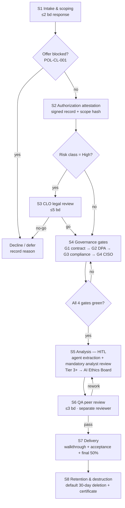

# 06 — Client Offerings: Reverse-Engineering Services (REA-Powered)

**Date:** 2026-10-17
**Owner:** CPO (product) + consulting-lead hat (delivery model)
**Sources:** `reports/rea-feasibility/00-rea-capabilities.md` (shared facts); `config/company/malawi_offers.yaml` (governance gates, offer risk pattern); `src/ai_company/services/client_intake.py` (4-gate onboarding, POL-CL-001); `docs/ai-caas-pricing-model.md` (50/50 payment rule); AGENTS.md §8 (tool vocabulary), §15 (evidence policy); Malawi Data Protection Act 2017/2024 + GDPR posture.
**Status:** Draft for CEO/CLO review — price bands are DIRECTIONAL only; reconcile with the financial-analyst pricing file before any public commitment (per CEO directive: no public pricing without CFO + CEO).

---

## 1. Phase 1 Offering Catalog

Six offerings, each a fixed-scope engagement built on REA (`github.com/morluto/rea`, MIT) as the core analysis engine. REA is the *tool*; the *product* is a governed, human-reviewed findings report plus the authorization/audit trail that makes the work defensible to boards, auditors, and regulators.

All offerings inherit the standing client-side preconditions:

- **Client attests lawful access** to the target artifact(s) — ownership, licensed right, or written authorization from the rights-holder. Signed authorization record is a hard prerequisite; no attestation, no engagement.
- **4 governance gates pass** before analysis work starts: G1 signed contract (`legal_owner`), G2 DPA + data classification (`data_privacy_officer`), G3 compliance risk assessment (`security_compliance_lead`), G4 CISO security review. Mirrors `client_intake.py` POL-CL-001.
- **Evidence stays client-side by default.** Where client-supplied artifacts must be processed on our infrastructure, the data-handling protocol applies: PII classification, encryption at rest, access logging, 30-day deletion, documented cross-border LLM flow consent.

### 1.1 Offering Summary Table

| # | Offering | Primary sector(s) | Risk class | Legal gate | Effort band | Price archetype (directional) |
|---|----------|-------------------|------------|------------|-------------|-------------------------------|
| R1 | Format Rescue — Legacy/Proprietary Interoperability Analysis | Agriculture, natural resources, financial services | Low | No (unless target is third-party commercial software) | S: 1–2 weeks | USD 2.5K–6K |
| R2 | Vendor Due-Diligence Audit | Financial services, telecom | Medium–High | Yes if third-party vendor binary is in scope | M: 3–5 weeks | USD 8K–25K |
| R3 | Competitor Product Teardown & Benchmarking | Telecom, financial services | High | Yes — mandatory | M–L: 4–8 weeks | USD 15K–40K |
| R4 | Firmware & Protocol Analysis (Legacy Modernization) | Telecom, natural resources | High | Yes — mandatory | L: 6–12 weeks | USD 20K–50K |
| R5 | Offline-Readiness & Low-Bandwidth App Assessment | NGOs, agriculture | Medium | No | S–M: 2–4 weeks | USD 4K–12K |
| R6 | MRV / Climate Data-Format Audit | Climate change, natural resources, agriculture | Low–Medium | No | S–M: 2–4 weeks | USD 5K–15K |

*Bands are USD for NGO/donor clients and EUR/USD-equivalent MWK for local SMEs (mixed-currency policy, aligned with the Malawi portfolio). Final numbers require CFO+CEO ratification.*

### 1.2 Offering Detail Cards

#### R1 — Format Rescue: Legacy / Proprietary Interoperability Analysis

- **Value prop:** Your 15-year-old accounting export, donor M&E spreadsheet chain, or proprietary sensor log format shouldn't be locked in one vendor's dying toolchain. We reverse-engineer the format, document it, and hand you a migration path — your data, your ownership, no vendor lock-in.
- **Client inputs:** Sample files (anonymized), original software name/version if known, target system for migration, schema/mapping wishes.
- **REA role:** Artifact parsing, format fingerprinting, structure extraction, reconstruction of field semantics. Agent does the bulk extraction; analyst verifies every inferred field against client-provided samples.
- **Deliverable:** Format specification document + field dictionary + sample converted dataset + migration runbook. Standard findings report (§3) as cover.
- **Risk class:** Low — client-owned data only. Elevates to Medium if a commercial third-party application binary must be inspected to decode the format → triggers legal gate.
- **Notes:** Natural attach to Offer C (Data & Reporting) for the downstream migration work.

#### R2 — Vendor Due-Diligence Audit

- **Value prop:** Before you sign a 3-year software contract or close an acquisition, we open the black box. What encryption does the vendor's app *actually* use? Does the "offline mode" really work, or does it silently phone home? Does the data leave Malawi?
- **Client inputs:** Procurement shortlist or target company, legally obtained installers/builds, contract draft (for claims cross-check), data-flow expectations.
- **REA role:** Binary inspection, network-behavior surface extraction, crypto-primitive identification, data-storage location mapping. REA + behavioral probes produce the evidence set.
- **Deliverable:** Vendor risk scorecard (claims-vs-reality matrix), data-flow map, encryption and telemetry findings, procurement recommendations. Standard findings report (§3) with vendor-facing appendix safe to share in negotiations.
- **Risk class:** Medium–High. Legal gate applies whenever the binary belongs to a third-party vendor — client must attest they are licensed/authorized to reverse-engineer (interop/interop-testing and due-diligence statutory exceptions vary by jurisdiction; CLO confirms per engagement).
- **Notes:** Directly serves the telecom and financial-services procurement cycles. Pairs with Offer B automation for remediation.

#### R3 — Competitor Product Teardown & Benchmarking

- **Value prop:** An evidence-based answer to "how do they do it, and how do we compete?" — architecture insights, feature-surface mapping, and performance characteristics, delivered as a board-ready competitive brief. Not speculation from press releases: actual artifact analysis.
- **Client inputs:** Legally acquired competitor product (retail purchase or licensed copy), competitive questions, target market context.
- **REA role:** Binary/system structure extraction, feature and protocol surface mapping, algorithm identification where relevant. Heavy lifting is agent-driven; human analyst owns interpretation and competitive framing.
- **Deliverable:** Competitive intelligence brief with architecture diagrams, feature comparison, differentiation implications. Standard findings report (§3), plus a 10-slide executive deck.
- **Risk class:** High — **legal gate mandatory every time.** CLO reviews jurisdiction-specific reverse-engineering exceptions (e.g., interoperability, security research) and terms-of-service exposure *before* any work. Findings limited to what lawful analysis supports; no circumvention of technical protection measures.
- **Notes:** Highest-margin offering but highest legal overhead. Cap concurrent R3 engagements to one per analyst pod until CLO has a standard playbook.

#### R4 — Firmware & Protocol Analysis (Legacy Modernization)

- **Value prop:** Your base-station controller, metering system, or industrial protocol stack from 2012 is out of support. We recover the protocol spec and firmware behavior so your engineers can build the replacement — before the last spare part dies.
- **Client inputs:** Firmware image or device access (client-owned or authorized), protocol captures (PCAP), hardware documentation, modernization constraints.
- **REA role:** Ghidra/IDA-backed firmware extraction and decompilation (via REA's Windows Ghidra P0 and IDA provider paths), protocol dissection, state-machine reconstruction.
- **Deliverable:** Protocol specification, firmware behavior model, modernization risk register, reference implementation notes for critical paths. Standard findings report (§3).
- **Risk class:** High — legal gate mandatory (critical-infrastructure adjacent; authorization chain must be airtight). Additional CISO review for any device that handles subscriber or payment data.
- **Notes:** Telecom-sector flagship. Longest engagements; only book when an engagement lead with hardware background is available.

#### R5 — Offline-Readiness & Low-Bandwidth App Assessment

- **Value prop:** For NGOs and agricultural programs operating on 2G/intermittent connectivity: does your app *actually* work offline, or does it fail silently when the network drops? We audit the binary for true offline behavior, sync-conflict handling, and bandwidth footprint.
- **Client inputs:** App build (authorized), connectivity profile of deployment sites, sync architecture expectations.
- **REA role:** JavaScript application workflow analysis and artifact reconstruction (per REA's documented JS workflows), network-call surface extraction, storage-layer inspection.
- **Deliverable:** Offline-readiness scorecard, data-loss risk findings, sync design recommendations, low-bandwidth optimization list. Standard findings report (§3).
- **Risk class:** Medium — client-owned or explicitly authorized app under assessment. Legal gate if the app is a third-party commercial product.
- **Notes:** Strong narrative fit with "offline-first, sovereign by design" positioning. Attach to Offer B/C remediation.

#### R6 — MRV / Climate Data-Format Audit

- **Value prop:** Carbon and climate programs lose auditability when measurement-reporting-verification data lives in opaque exporter formats. We decode the formats, document the provenance chain, and flag integrity gaps before your donor or verifier does.
- **Client inputs:** Export files from MRV/registry/monitoring platforms, methodology notes, audit questions.
- **REA role:** Format fingerprinting and structure recovery (same engine as R1, applied to MRV/registry schemas), integrity-check reconstruction.
- **Deliverable:** Format specification, data-provenance map, integrity-gap register, remediation plan. Standard findings report (§3).
- **Risk class:** Low–Medium — client-owned data. No legal gate unless third-party platform binaries are in scope.
- **Notes:** Differentiator for the climate/natural-resources sector where no local competitor offers this.

---

## 2. Engagement SOP with Stage Gates and SLAs

The engagement lifecycle reuses the existing client-intake governance machinery (`client_intake.py`, POL-CL-001) and adds REA-specific gates for authorization attestation and human review.

### 2.1 Stage Definitions and SLA Targets

| Stage | Owner | Gate to exit | SLA target |
|-------|-------|--------------|------------|
| **S1. Intake & scoping** | Engagement lead | Scope brief + offer code assigned; offer-blocked check passes | First response ≤ 2 business days; scope brief draft ≤ 5 business days |
| **S2. Authorization & scope attestation** | Engagement lead + client | Signed authorization record covering every target artifact; scope hash frozen | ≤ 5 business days from S1 |
| **S3. Legal review (high-risk only)** | CLO | CLO memo: jurisdiction, ToS exposure, technical-protection-measures assessment, go/no-go | ≤ 5 business days |
| **S4. Governance gates G1–G4** | Intake service (automated) + gate owners | All 4 gates green: contract, DPA + data classification, compliance risk assessment, CISO security review | G1–G2: ≤ 10 business days; G3–G4: ≤ 5 business days after G2 |
| **S5. Analysis (HITL)** | REA analyst (human) + agent pod | Every finding has evidence reference; agent output reviewed line-by-line by analyst; Tier 3+ deliverables routed to AI Ethics Board | Per effort band (see §1.1); analyst review ≥ 30% of analysis calendar |
| **S6. QA peer review** | Peer reviewer (different human than analyst) | QA checklist green (§6); rework triggers cleared | ≤ 3 business days |
| **S7. Delivery** | Engagement lead | Client walkthrough delivered; acceptance sign-off; 50% final payment trigger | Within 5 business days of S6 |
| **S8. Retention & destruction** | Data privacy officer | Artifacts deleted on client schedule (default 30 days post-acceptance); destruction certificate issued | Certificate within 5 business days of deletion date |

**Non-negotiables:**

- No client work begins before S4 completes (G1–G4). High-risk offerings also cannot begin before S3 clears.
- The signed S2 authorization record is archived with the findings report and is part of the delivered package.
- Evidence produced during S5 lives in a directory disjoint from the report output (per AGENTS.md §9.3 audit evidence separation) and is read-only for all audit/check tooling.

### 2.2 Engagement Flow Diagram



---

## 3. Standard REA Findings Report Template

Every client-facing deliverable, across all six offerings, uses this structure. The report is the product of record; intermediate artifacts stay internal (unless explicitly contracted, e.g., R1 format spec is a contracted annex).

```markdown
# REA Findings Report — [Client] / [Offering code] / [Engagement ID]
Report date · Classification · Version

## 1. Executive Summary
Non-technical narrative: what was analyzed, the 3–5 findings that matter, and what
the client should do next. Written for a board or program director.

## 2. Method & Tools
- Targets analyzed (artifact identifiers, versions, hashes)
- Toolchain: REA version + components used (e.g., Ghidra P0, IDA provider,
  JS application workflows), plus any manual analysis steps
- What was NOT analyzed (explicit out-of-scope list — evidence honesty, AGENTS.md §15)

## 3. Evidence References
Every finding links to an evidence ID (log line, decompilation excerpt, PCAP frame,
file hash). Evidence set is archived per retention policy; IDs are re-derivable.

## 4. Findings
Numbered findings. Each includes: title, severity, evidence refs, plain-language
explanation, confidence level (High/Medium/Low with reasoning).

## 5. Limitations & Confidence
- Known gaps (encrypted sections not recoverable, samples unrepresentative, etc.)
- Overall confidence statement — what this report does and does not prove
- Residual risks that could not be assessed from available artifacts

## 6. Recommendations
Prioritized, actionable, owner-suggested. Distinguish "act now" from "monitor"
from "requires further engagement."

## 7. Authorization Record
- Client attestation summary (signed S2 record reference)
- Governance gate completion record (G1–G4 evidence IDs, dates, reviewers)
- Legal gate memo reference (if applicable)
- IP posture: client owns findings; Lightspeed retains methods and tooling
  (see §4.4)
```

---

## 4. Pricing & Packaging Mechanics

### 4.1 Payment Structure

- **Fixed-fee engagements only.** No open-ended hourly work (per compliance/legal budget policy: fixed-fee engagements only; CLO manages; CEO approves).
- **50% upfront / 50% on delivery-acceptance.** Inherited from the Malawi catalog pricing rule (docs/ai-caas-pricing-model.md). Upfront covers mobilization; final 50% triggers at S7 acceptance sign-off.
- **Currency:** USD for NGO/donor clients; MWK or mixed for local SMEs per malawi_offers.yaml convention. MWK/USD hedging sign-off required per CEO directive on pricing deviations.
- **Liability cap:** 100% of fees, per ratified service-level liability cap policy.

### 4.2 Inclusions / Exclusions

| Included in base fee | Excluded (change-order or separate engagement) |
|----------------------|--------------------------------------------------|
| Scope-bound REA analysis per S2 attestation | Artifacts added after scope-hash freeze |
| Standard findings report (§3) | Custom report formats for downstream systems |
| One analyst + one peer reviewer | Specialist hardware lab time (R4 edge cases) |
| Client walkthrough + 30-day Q&A on findings | Remediation implementation (routes to Offer B/C) |
| Evidence retention for 30 days post-acceptance | Extended retention beyond 30 days (billed monthly, client-requested) |
| Destruction certificate at deletion | Re-analysis after client-side changes to target |

### 4.3 Change-Order Triggers

Automatic change order (re-scope + re-price, re-attest if new artifacts) when any of:

1. New target artifacts introduced after scope-hash freeze.
2. Risk class escalates (e.g., client-owned → third-party vendor binary → legal gate added).
3. Effort-band overrun > 25% caused by client-side delays or incomplete inputs.
4. Request for implementation/remediation work (spawns separate Offer B/C engagement).

### 4.4 IP & Evidence Retention

- **Client owns findings.** All reports, specs, scorecards, and contracted annexes are work product delivered to the client under the MSA.
- **Lightspeed retains methods.** REA configurations, custom analysis scripts, and engagement playbooks remain Lightspeed IP. No client deliverable includes agent prompts, internal tooling, or evidence-store internals.
- **Evidence retention:** client-supplied artifacts and derived evidence deleted 30 days after acceptance (default), per data-handling protocol. Client may elect longer retention in writing at contract time (fee applies).
- **Audit trail:** authorization record + gate evidence + destruction certificate form the audit pack, retained per our own compliance requirements (access-logged, encrypted at rest).

---

## 5. Capacity & Delivery Team

### 5.1 Team Shape Per Engagement

| Role | Responsibility | Who (registry) | Present on |
|------|----------------|----------------|------------|
| **Engagement lead** | Client interface, scope control, S1/S2/S7 ownership | Solutions engineer / consulting lead | All |
| **REA analyst** | Owns S5: runs REA, produces findings, line-by-line review of agent output | Analyst pod (technical) | All |
| **Peer reviewer** | S6 QA: independent of analyst, checklist owner | Second analyst or senior reviewer | All |
| **Legal (CLO or retained counsel)** | S3 memo, ongoing jurisdiction questions | CLO | R3, R4 always; R2 when third-party binary in scope |
| **Data privacy officer** | G2, PII classification, destruction certificate | data-privacy-officer | All |
| **CISO / security lead** | G4, sensitive-data path review | ciso | R4 always; others when subscriber/payment data present |
| **AI Ethics Board** | Tier 3+ deliverable review | ai-ethics-board-chair | When deliverable tier ≥ 3 |

### 5.2 Agent-vs-Human Split

| Workstream | Agent share | Human share | Rule |
|------------|-------------|-------------|------|
| Artifact triage, format fingerprinting, bulk decompilation, evidence indexing | High (~80–90% volume) | Analyst validates samples | Agents never emit client-facing text |
| Finding interpretation, severity scoring, narrative | Low | Analyst 100% | Every finding originates as human judgment |
| Report drafting | Medium (first draft from analyst notes) | Analyst rewrites; peer reviewer checks | No agent text ships to client unreviewed |
| Legal, pricing, authorization, acceptance | Zero | Humans only | AGENTS.md §15 evidence policy: no agent assertion counts as proof |

**Mandatory human review is absolute:** no REA-derived finding reaches a client deliverable without analyst line-by-line sign-off and peer QA. Agent throughput is an accelerator, not a reviewer.

### 5.3 Capacity Model (Phase 1)

- **Concurrent engagements cap: 3** across the catalog (1 per pod), until first 6 engagements are complete and the CLO R3/R4 playbook is ratified.
- **Pod = 1 analyst + 1 peer reviewer shared at 0.5 FTE each.** Engagement lead may cover 2 pods.
- **Escalation:** scope creep, legal ambiguity, or evidence-integrity concerns route to CPO (product) with CLO in the loop; strategic/liability questions escalate to CEO per governance.
- **Capacity trigger to hire:** utilization > 75% for two consecutive quarters, or waitlist > 2 qualified prospects in any single offering.

---

## 6. Quality Gates & Acceptance Criteria

### 6.1 Definition of Done (per engagement)

An engagement is Done when **all** of the following are true:

1. Standard findings report (§3) delivered, every finding carrying an evidence reference and a confidence level.
2. Authorization record and gate evidence (G1–G4, legal memo if applicable) archived and included in the audit pack.
3. Peer-review checklist (§6.2) fully green; zero open P0/P1 rework items.
4. Client walkthrough completed; written acceptance sign-off received; final 50% payment triggered.
5. Retention/destruction schedule confirmed with data privacy officer.

### 6.2 Peer-Review Checklist (S6 exit criteria)

- [ ] Every finding has ≥ 1 re-derivable evidence reference
- [ ] No claim without evidence (AGENTS.md §15 — retract-and-restate if any found)
- [ ] Limitations section names real gaps; no overclaiming beyond artifacts analyzed
- [ ] Confidence levels assigned with reasoning, not defaults
- [ ] Executive summary matches the body (no finding appears in summary but not in §4)
- [ ] Out-of-scope list is explicit and honest
- [ ] Authorization record section complete and consistent with gate store
- [ ] No agent-generated prose shipped unreviewed (spot-check ≥ 10% of report text against draft lineage)

### 6.3 Rework Triggers (return to S5)

| Trigger | Source | Response |
|---------|--------|----------|
| Finding without evidence reference | Peer reviewer | Return finding to analyst; do not deliver |
| Client acceptance rejected with substantive objection | S7 walkthrough | Re-open analysis limited to disputed findings; change order if scope-related |
| Evidence integrity break (missing hashes, overwritten evidence dir) | Any stage | Discard run, re-fetch evidence from clean source, re-run (per §9.3 incident rule) |
| Legal posture change mid-engagement (new ruling, ToS change) | CLO | Pause S5; re-run S3 memo; resume or terminate with partial fee per MSA |

### 6.4 Continuous Improvement

- Post-acceptance retro (analyst + reviewer, 30 min) logged per engagement; playbook updates proposed to the CPO when a pattern appears twice.
- Rework rate, legal-gate turnaround, and SLA adherence are the three Phase 1 quality KPIs reported monthly to the CEO.

---

*End of file. Next: reconcile §1.1 price bands with the financial-analyst pricing file; CLO review of R3/R4 legal-gate playbook before first high-risk booking.*
